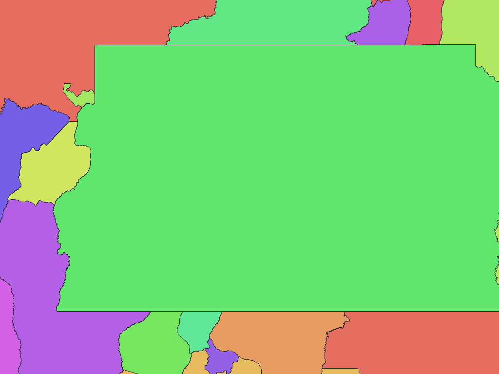

# ブラジルIBGE地区区域（Censo Demográfico 2022）

[English](br-2022-ibge-gov-br-distritos-adm-rev1.md) | 日本語

[データセット目次に戻る](../../datasets/README.ja.md)

## 概要

原典の地区・運用区域が表すブラジル全域。本土、島嶼および飛地を含む。 Censo Demográfico 2022の確定版Malha de Distritos。区域の基準日は2022年7月31日。原典ファイルは`BR_distritos_CD2022.zip`。

## 区域数

辞書コード単位で **10,699区域** を収録します。通常地区10,698区域と州所属の湖面運用区域1区域、計10,699区域。通常地区の上位名称は27の州・連邦区と5,570の自治体相当区域。 上位名称は辞書階層であり、独立した画素値ではありません。対象範囲と時点の詳細はZIP内の`data-spec.md`を参照してください。

## ダウンロード

[br-2022-ibge-gov-br-distritos-adm-rev1.zipをダウンロード（22.78 MiB）](https://github.com/nyatla/galuchat-gis-sdk/releases/download/v0.2.4/br-2022-ibge-gov-br-distritos-adm-rev1.zip)

このリンクはv0.2.4の公開後に利用できます。ZIPはローカルの`release/`に作成済みです。

## 地図の解像度とサイズ

| unitInv | 南北方向の画素間隔の目安 | WGSMapSetサイズ |
| ---: | ---: | ---: |
| 100 | 約1.1 km | 368.5 KiB |
| 1000（標準） | 約111 m | 2.75 MiB |
| 10000 | 約11 m | 21.30 MiB |

## 辞書

| GisWordBookの文字コード | サイズ |
| --- | ---: |
| UTF-8 | 149.1 KiB |
| UTF-16LE | 149.2 KiB |

同梱の`names.csv`で辞書コードと原典の識別子・名称を照合できます。地図と辞書は同じZIPから選んでください。

### GisWordBookの構造

各レコードは固定3スロットのStringSetです。

| 位置 | 意味 | 空値 |
| ---: | --- | --- |
| 1 | Unidade da Federação（州・連邦区）の名称。原典の`NM_UF`。 | 不可 |
| 2 | Município相当（自治体相当区域）の名称。原典の`NM_MUN`。 | 可。州直属の運用区域では空文字列。 |
| 3 | 末端区域の表示名。通常地区の`NM_DIST`または運用区域の補完表記。 | 不可 |

実データ例（辞書コード`1`）：

```json
["Rio Grande do Sul","","Área operacional: Lagoa dos Patos e Lagoa Mirim"]
```

地図の非ゼロ値が辞書コードです。`0`は背景で、辞書レコードを指しません。空スロットがある場合も位置を詰めません。

## 描画例

<a href="../../docs/image/br-2022-ibge-gov-br-distritos-adm-unit-inv-1000.png"></a>

Brasília付近を`unitInv=1000`で描画しました。青色は背景、その他の色は区域コードの区別を示し、色自体に別の意味はありません。

## ライセンスと利用条件

原典：[原典 1](https://www.ibge.gov.br/estatisticas/sociais/populacao/22827-censo-demografico-2022.html?edicao=41851&t=resultados), [原典 2](https://geoftp.ibge.gov.br/organizacao_do_territorio/malhas_territoriais/malhas_de_setores_censitarios__divisoes_intramunicipais/censo_2022/distritos/shp/BR/BR_distritos_CD2022.zip)。

原典のライセンス・利用条件：**Brazilian federal open-data legislation and IBGE policy; no individual CC licence identified**（[規約 1](https://www.planalto.gov.br/ccivil_03/_ato2015-2018/2016/decreto/d8777.htm), [規約 2](https://www.planalto.gov.br/ccivil_03/_ato2019-2022/2021/lei/l14129.htm), [規約 3](https://www.ibge.gov.br/acesso-informacao/acoes-e-programas/infraestrutura-nacional-de-dados-abertos-inda.html?lang=pt-BR)）。ZIP内の`NOTICE.md`に出典、適用条件、帰属表示および加工内容を記録しています。

### 商用利用・許諾申請（参考）

確認した公開データ規定を再利用の根拠とし、個別の事前許可手続は確認していません。この原典に個別のCreative Commonsライセンスがあるとは扱いません。現行の公式規定とNOTICE.mdを確認してください。 これは参考情報であり、正式な利用許諾や法的判断を示すものではありません。

### 出典・加工・承認表示

ZIP内の`NOTICE.md`に記載した出典・加工表示を維持してください。この加工データを原典提供者の公式・公認・推奨製品として表示しません。

## 利用上の注意

同じZIPから用途に合う地図1つとGisWordBook1つを選びます。サイズはZIP内ファイルの実サイズ、画素間隔は概算です。区域範囲、コード対応、制約はZIP内の原典文書を確認してください。
