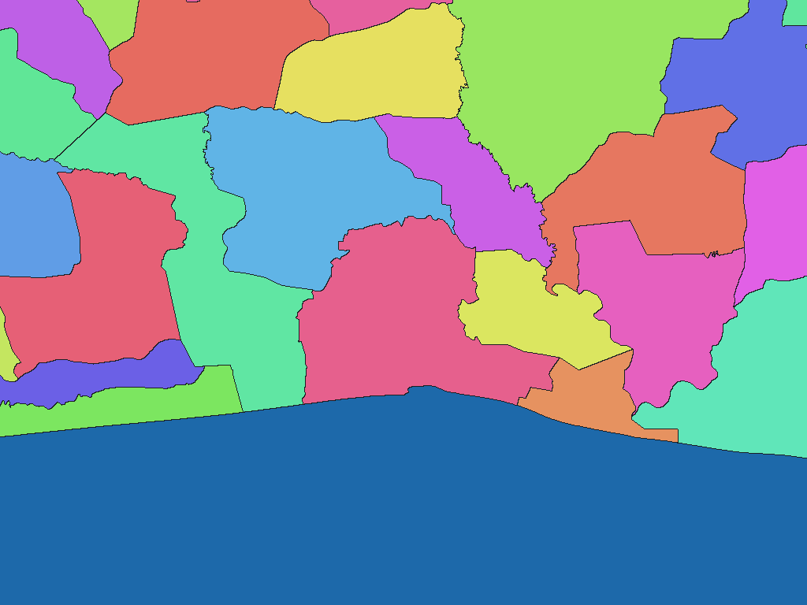

# Côte d’Ivoire sub-prefecture boundaries (RGPH 2021-derived)

English | [日本語](ci-2021-anstat-ci-sprefectures-adm.ja.md)

[Back to dataset index](../../datasets/README.md)

## Overview

ANStat SousPrefecture boundaries with District, Région-equivalent, Département and Sous-préfecture names. The edition is derived from RGPH 2021; the source XML was last exported in 2025.

## Area counts

There are **510 areas by dictionary code**. 510 sub-prefectures under 14 Districts, 33 Région-equivalent units and 111 Départements. The Région-equivalent level includes two autonomous Districts. Parent names are dictionary levels, not additional pixel values. See the ZIP's `data-spec.md` for exact coverage and dates.

## Download

[Download ci-2021-anstat-ci-sprefectures-adm-rev1.zip (1011.3 KiB)](https://github.com/nyatla/galuchat-gis-sdk/releases/download/v0.2.4/ci-2021-anstat-ci-sprefectures-adm-rev1.zip)

This link will work after v0.2.4 is published. The ZIP is already prepared in the local `release/` directory.

## Map resolutions and sizes

| unitInv | Approx. north–south pixel distance | WGSMapSet size |
| ---: | ---: | ---: |
| 100 | approx. 1.1 km | 19.1 KiB |
| 1000 (default) | approx. 111 m | 129.2 KiB |
| 10000 | approx. 11 m | 919.0 KiB |

## Dictionaries

| GisWordBook encoding | Size |
| --- | ---: |
| UTF-8 | 5.3 KiB |
| UTF-16LE | 5.5 KiB |

The included `names.csv` maps dictionary codes to source identifiers and names. Use the map and dictionary from the same ZIP.

### GisWordBook structure

Each record has 4 fixed StringSet slots.

| Position | Meaning |
| ---: | --- |
| 1 | District name |
| 2 | Région-equivalent name (including autonomous Districts) |
| 3 | Département name |
| 4 | Sous-préfecture name |

Actual example (dictionary code `1`):

```json
["COMOE","INDENIE-DJUABLIN","ABENGOUROU","ABENGOUROU"]
```

Nonzero map values are dictionary codes. Code `0` is background and does not identify a dictionary record. Empty slots, where present, are retained rather than shifted.

## Rendering example

<a href="../../docs/image/ci-2021-anstat-ci-sprefectures-adm-unit-inv-1000.png"></a>

Rendered near Abidjan at `unitInv=1000`. Blue denotes background; other colours distinguish area codes without additional meaning.

## License and terms of use

Original data: [official source](https://geoportail.anstat.ci/).

Original licence or terms: **CC BY 4.0 and ANStat terms** ([official licence/terms 1](https://creativecommons.org/licenses/by/4.0/), [official licence/terms 2](https://www.anstat.ci/privacy)). The ZIP's `NOTICE.md` records the source, applicable terms, attribution and processing for this release.

### Commercial use and permission applications (informational)

The cited CC BY 4.0 terms permit commercial reuse without a separate licence application when their conditions are met. Check the source's current terms and the ZIP's NOTICE.md for your use. This is informational, not a formal grant of permission or a legal determination.

### Attribution, modification and approval notices

Preserve the source and modification notices specified in the ZIP's `NOTICE.md`. This processed dataset is not presented as an official, approved or endorsed product of the source provider.

## Usage notes

Select one map resolution and one GisWordBook from this ZIP. File sizes are actual uncompressed member sizes; pixel distances are approximate. The source documents in the ZIP define coverage, code mapping and limitations.
