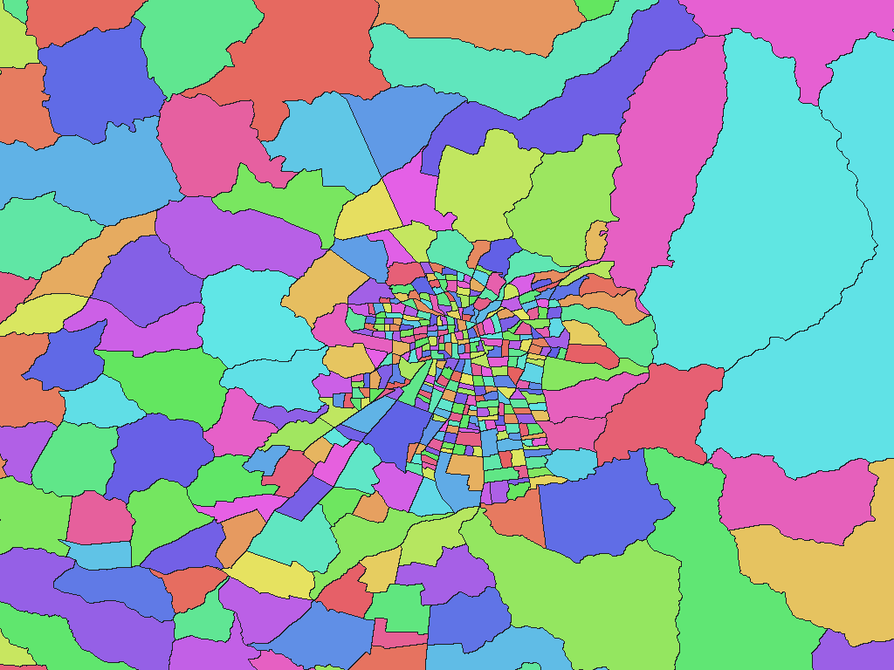

# Chilean census districts (APC 2023)

English | [日本語](cl-2023-ine-gob-cl-apc-stat-distrito-censal-rev1.ja.md)

[Back to dataset index](../../datasets/README.md)

## Overview

Census-district boundaries from Actualización Precensal 2023. They are not treated as a 2017 boundary edition, even though the local source-directory name contains 2017.

## Area counts

There are **2,768 areas by dictionary code**. 2,768 census districts under 16 Regions, 56 Provincias and 345 Comunas. Parent names are dictionary levels, not additional pixel values. See the ZIP's `data-spec.md` for exact coverage and dates.

## Download

[Download cl-2023-ine-gob-cl-apc-stat-distrito-censal-rev1.zip (7.74 MiB)](https://github.com/nyatla/galuchat-gis-sdk/releases/download/v0.2.3/cl-2023-ine-gob-cl-apc-stat-distrito-censal-rev1.zip)

This link will work after v0.2.3 is published. The ZIP is already prepared in the local `release/` directory.

## Map resolutions and sizes

| unitInv | Approx. north–south pixel distance | WGSMapSet size |
| ---: | ---: | ---: |
| 100 | approx. 1.1 km | 69.7 KiB |
| 1000 (default) | approx. 111 m | 782.4 KiB |
| 10000 | approx. 11 m | 7.23 MiB |

## Dictionaries

| GisWordBook encoding | Size |
| --- | ---: |
| UTF-8 | 35.4 KiB |
| UTF-16LE | 35.4 KiB |

The included `names.csv` maps dictionary codes to source identifiers and names. Use the map and dictionary from the same ZIP.

### GisWordBook structure

Each record has 5 fixed StringSet slots.

| Position | Meaning |
| ---: | --- |
| 1 | Region name |
| 2 | Provincia name |
| 3 | Comuna name |
| 4 | Distrito censal name |
| 5 (attribute) | TIPO_DISTR classification (attribute, not an area) |

Actual example (dictionary code `1`):

```json
["TARAPACÁ","IQUIQUE","IQUIQUE","PUERTO","URBANO"]
```

Nonzero map values are dictionary codes. Code `0` is background and does not identify a dictionary record. Empty slots, where present, are retained rather than shifted.

## Rendering example

<a href="../../docs/image/cl-2023-ine-gob-cl-apc-stat-distrito-censal-unit-inv-1000.png"></a>

Rendered near Santiago at `unitInv=1000`. Blue denotes background; other colours distinguish area codes without additional meaning.

## License and terms of use

Original data: [official source](https://www.ine.gob.cl/herramientas/portal-de-mapas/geodatos-abiertos).

Original licence or terms: **CC BY-SA 4.0 and INE terms** ([official licence/terms 1](https://creativecommons.org/licenses/by-sa/4.0/), [official licence/terms 2](https://www.ine.gob.cl/terminos-de-uso-y-licencia-de-datos-abiertos)). The ZIP's `NOTICE.md` records the source, applicable terms, attribution and processing for this release.

### Commercial use and permission applications (informational)

The cited CC BY-SA 4.0 terms permit commercial reuse; adapted material is subject to the share-alike condition. No separate application is stated for uses covered by that licence. Check the current INE terms and NOTICE.md. This is informational, not a formal grant of permission or a legal determination.

### Attribution, modification and approval notices

Preserve the source and modification notices specified in the ZIP's `NOTICE.md`. This processed dataset is not presented as an official, approved or endorsed product of the source provider.

## Usage notes

Select one map resolution and one GisWordBook from this ZIP. File sizes are actual uncompressed member sizes; pixel distances are approximate. The source documents in the ZIP define coverage, code mapping and limitations.
