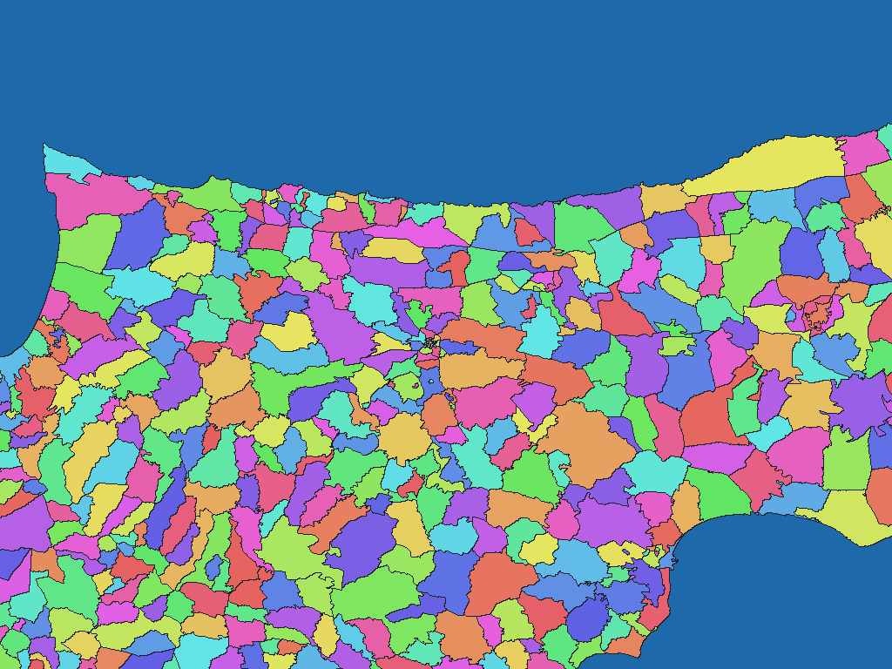

# キプロス行政区域（2024年8月版）

[English](cy-2024-data-gov-cy-administrative-units-adm-rev1.md) | 日本語

[データセット目次に戻る](../../datasets/README.ja.md)

## 概要

採用原典の6県に属する区画が表すキプロスの範囲。北部を含む。 Administrative_Units_GR_Shapefiles_AUGUST2024、2024年8月版。2024年7月の自治体再編を原典に収録された範囲で反映する。

## 区域数

辞書コード単位で **744区域** を収録します。市・共同体等の細区画615件を基礎とし、街区を持つ30区画では下位の159街区を採用する。末端区域は街区のない585区画と159街区、計744区域。 上位名称は辞書階層であり、独立した画素値ではありません。対象範囲と時点の詳細はZIP内の`data-spec.md`を参照してください。

## ダウンロード

[cy-2024-data-gov-cy-administrative-units-adm-rev1.zipをダウンロード（449.0 KiB）](https://github.com/nyatla/galuchat-gis-sdk/releases/download/v0.2.4/cy-2024-data-gov-cy-administrative-units-adm-rev1.zip)

このリンクはv0.2.4の公開後に利用できます。ZIPはローカルの`release/`に作成済みです。

## 地図の解像度とサイズ

| unitInv | 南北方向の画素間隔の目安 | WGSMapSetサイズ |
| ---: | ---: | ---: |
| 100 | 約1.1 km | 5.4 KiB |
| 1000（標準） | 約111 m | 43.9 KiB |
| 10000 | 約11 m | 370.3 KiB |

## 辞書

| GisWordBookの文字コード | サイズ |
| --- | ---: |
| UTF-8 | 11.7 KiB |
| UTF-16LE | 11.8 KiB |

同梱の`names.csv`で辞書コードと原典の識別子・名称を照合できます。地図と辞書は同じZIPから選んでください。

### GisWordBookの構造

各レコードは固定4スロットのStringSetです。

| 位置 | 意味 | 空値 |
| ---: | --- | --- |
| 1 | Επαρχία（県）のDIST_NM_G。 | 不可 |
| 2 | 合併後の市名、または原典の非再編市・共同体等の名称。 | 不可 |
| 3 | 合併後市に属する構成地区名。原典細区画名称の新市名との併記から細区画名を採用する。 | 空文字可（スロットは固定）。該当する構成地区を置かない場合は空文字列。 |
| 4 | 原典に収録されたΕνορία（街区）のQRTR_NM_G。 | 空文字可（スロットは固定）。街区のない区画では空文字列。 |

実データ例（辞書コード`1`）：

```json
["ΛΕΥΚΩΣΙΑ","Δήμος Λευκωσίας","ΛΕΥΚΩΣΙΑ","ΑΓΙΟΣ ΑΝΔΡ"]
```

地図の非ゼロ値が辞書コードです。`0`は背景で、辞書レコードを指しません。空スロットがある場合も位置を詰めません。

## 描画例

<a href="../../docs/image/cy-2024-data-gov-cy-administrative-units-adm-unit-inv-1000.png"></a>

Nicosia付近を`unitInv=1000`で描画しました。青色は背景、その他の色は区域コードの区別を示し、色自体に別の意味はありません。

## ライセンスと利用条件

原典：[原典 1](https://www.data.gov.cy/en/dataset/187), [原典 2](https://www.data.gov.cy/sites/default/files/Administrative_Units_GR_Shapefiles_AUGUST2024_0.zip)。

原典のライセンス・利用条件：**CC BY 4.0**（[規約 1](https://creativecommons.org/licenses/by/4.0/), [規約 2](https://creativecommons.org/licenses/by/4.0/legalcode.en)）。ZIP内の`NOTICE.md`に出典、適用条件、帰属表示および加工内容を記録しています。

### 商用利用・許諾申請（参考）

原典が示すCC BY 4.0は、条件に従う商用利用を認めています。確認した資料には、この範囲での個別許諾申請の指定はありません。用途に応じて現行の原典条件とZIP内のNOTICE.mdを確認してください。 これは参考情報であり、正式な利用許諾や法的判断を示すものではありません。

### 出典・加工・承認表示

ZIP内の`NOTICE.md`に記載した出典・加工表示を維持してください。この加工データを原典提供者の公式・公認・推奨製品として表示しません。

## 利用上の注意

同じZIPから用途に合う地図1つとGisWordBook1つを選びます。サイズはZIP内ファイルの実サイズ、画素間隔は概算です。区域範囲、コード対応、制約はZIP内の原典文書を確認してください。
