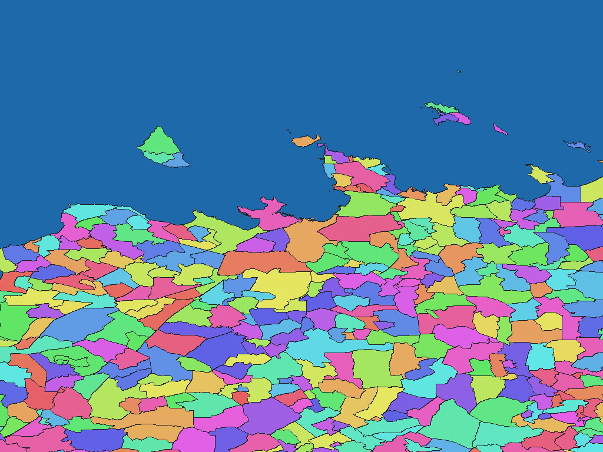

# Estonian settlement units, 2026

English | [日本語](ee-2026-geoportaal-maaamet-ee-asustusyksus-adm-rev1.ja.md)

[Back to dataset index](../../datasets/README.md)

## Overview

This package contains settlement units in Estonia, converted from the source described in the ZIP's `data-spec.md`. Nonzero WGSMapSet pixel values are codes in the accompanying GisWordBook. `names.csv` maps those codes to source identifiers.

## Area counts

**4,715 areas by dictionary code.** The source has 4,717 shapes representing 4,715 distinct settlement units. The source specification records the underlying area counts and any special cases.

## Download

[Download ee-2026-geoportaal-maaamet-ee-asustusyksus-adm-rev1.zip (2.19 MiB)](https://github.com/nyatla/galuchat-gis-sdk/releases/download/v0.2.2/ee-2026-geoportaal-maaamet-ee-asustusyksus-adm-rev1.zip)

The download link becomes available after v0.2.2 is published; the ZIP is prepared locally.

## Map resolutions and sizes

| unitInv | Approx. north–south pixel distance | File | Size |
| ---: | ---: | --- | ---: |
| 100 | about 1.1 km | `estonia_asustusyksus_2026-grid-512-100.wgsmapset.glc` | 44.3 KiB |
| 1000 (default) | about 111 m | `estonia_asustusyksus_2026-grid-4096-1000.wgsmapset.glc` | 284.6 KiB |
| 10000 | about 11 m | `estonia_asustusyksus_2026-grid-8192-10000.wgsmapset.glc` | 1.82 MiB |

## GisWordBooks and structure

| Encoding | File | Size |
| --- | --- | ---: |
| UTF-8 | `estonia_asustusyksus_2026.giswordbook` | 88.1 KiB |
| UTF-16LE | `estonia_asustusyksus_2026.utf16.giswordbook` | 88.2 KiB |

Each dictionary record has 4 fixed StringSet slots:

| Slot | Meaning |
| ---: | --- |
| 1 | County |
| 2 | Municipality |
| 3 | Settlement unit |
| 4 | Source TYYP type |

Actual record at dictionary code `1`:

```json
["Harju maakond","Tallinn","Haabersti linnaosa","6"]
```

Use a map and dictionary from the same ZIP. Pixel code `0` denotes background, not a separate water class. The `names.csv` file preserves source IDs.

## Rendering example

<a href="../../docs/image/ee-2026-geoportaal-maaamet-ee-asustusyksus-adm-unit-inv-1000.png"></a>

Rendered from the `unitInv=1000` map; colors distinguish codes without semantic meaning.

## License and terms of use

Source: [Original provider page](https://geoportaal.maaamet.ee/est/ruumiandmed/haldus-ja-asustusjaotus-p119.html). The source terms recorded in the ZIP's `NOTICE.md` are **Provider's open-data terms**; see the [Official terms](https://kataster.ee/sites/default/files/documents/2024-03/MTP_andmeteenuste_kasutustingimused.pdf).

### Commercial use and permission applications (informational)

The provider describes the source as open data, but the linked terms should be checked for the intended commercial use and any application requirement. This summary is informational, not a formal grant of permission or a legal determination. Verify the current official terms and the ZIP's `NOTICE.md` for your intended use.

### Attribution, modification and approval notices

Keep the source attribution and processing information in the ZIP's `NOTICE.md` when redistributing the processed product. Do not present it as an official or endorsed product of the source provider.
