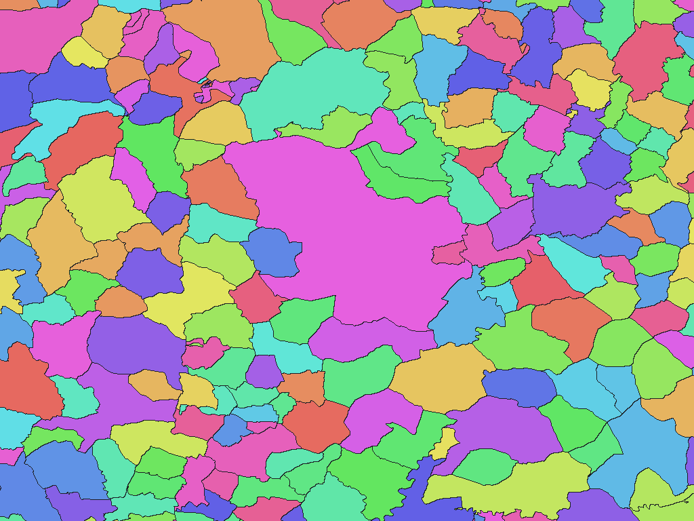

# Spanish administrative areas, BDDAE 2026

English | [日本語](es-2026-cnig-es-lilim-adm-rev1.ja.md)

[Back to dataset index](../../datasets/README.md)

## Overview

Administrative areas from the 2026-07-28 update of IGN/CNIG's Base de Datos de Divisiones Administrativas de España (BDDAE). The map includes ordinary municipalities, shared-jurisdiction areas and other special areas, and the source's Territorio areas. The dictionary stores autonomous-community, province and municipality/special-area names; `names.csv` maps them to source identifiers.

## Area counts

There are **8,220 areas by dictionary code**, matching 8,220 adopted source areas. No distinct areas share a full name path in this edition. This is not a polygon count or the count visible at each resolution.

## Download

[Download es-2026-cnig-es-lilim-adm-rev1.zip (6.76 MiB)](https://github.com/nyatla/galuchat-gis-sdk/releases/download/v0.2.4/es-2026-cnig-es-lilim-adm-rev1.zip)

This link will work after v0.2.4 is published. The ZIP is already prepared in the local `release/` directory.

## Map resolutions and sizes

| unitInv | Approx. pixel distance | WGSMapSet size |
| ---: | ---: | ---: |
| 100 | approx. 1.1 km | 118.3 KiB |
| 1000 (default) | approx. 111 m | 871.0 KiB |
| 10000 | approx. 11 m | 5.88 MiB |

## Dictionaries

| GisWordBook encoding | Size |
| --- | ---: |
| UTF-8 | 110.0 KiB |
| UTF-16LE | 110.1 KiB |

The included `names.csv` maps dictionary codes to source NATCODE/INSPIREID identifiers and area classifications.

### GisWordBook structure

Each record has three fixed StringSet slots. Missing parent levels remain empty strings.

| Position | Meaning | Empty values |
| ---: | --- | --- |
| Area 1 | Autonomous community or city name | Possible |
| Area 2 | Province or corresponding autonomous-city level | Possible |
| Area 3 | Municipality or special-area name | Not allowed |

Actual example (dictionary code `1`):

```json
["Andalucía","Almería","Abla"]
```

Nonzero map values are dictionary codes; code `0` is background, not a dictionary record. The inclusion of Territorio areas such as Gibraltar reflects the source dataset and is not a statement about sovereignty.

## Rendering example

<a href="../../docs/image/es-cnig-bddae-2026-unit-inv-1000.png"></a>

Rendered near Madrid at `unitInv=1000`. Blue denotes background; other colors distinguish area codes without additional meaning.

## License and terms of use

Source: Instituto Geográfico Nacional de España (IGN) / Centro Nacional de Información Geográfica (CNIG), [BDDAE/LILIM](https://centrodedescargas.cnig.es/CentroDescargas/catalogo.do?Serie=LILIM).

See the [IGN terms](https://www.ign.es/resources/licencia/Condiciones_licenciaUso_IGN.pdf) and [CC BY 4.0](https://creativecommons.org/licenses/by/4.0/). Attribution, license link and modification notice must be retained.

### Commercial use and permission applications (informational)

CC BY 4.0 permits commercial use subject to its conditions. An individual permission application is generally unnecessary for uses covered by the license. This is informational, not a legal determination; check the official terms and the ZIP's `NOTICE.md` for your use.

### Attribution, modification and approval notices

The NOTICE records:

> Obra derivada de BDLJE Continua CC-BY 4.0 [ign.es](https://www.ign.es/)
>
> IGN/CNIGの2026-07-28更新版をもとに、区域・名称の統合、階層の正規化、値の再割当およびGaluchat用の形式変換を行った。

## Usage notes

Always use a map and dictionary from the same ZIP. Typically choose one map and the UTF-8 dictionary. Sizes are actual file sizes and pixel distances are approximate north-south distances. See the ZIP's `data-spec.md` for coverage and limitations and `NOTICE.md` for rights and terms.
