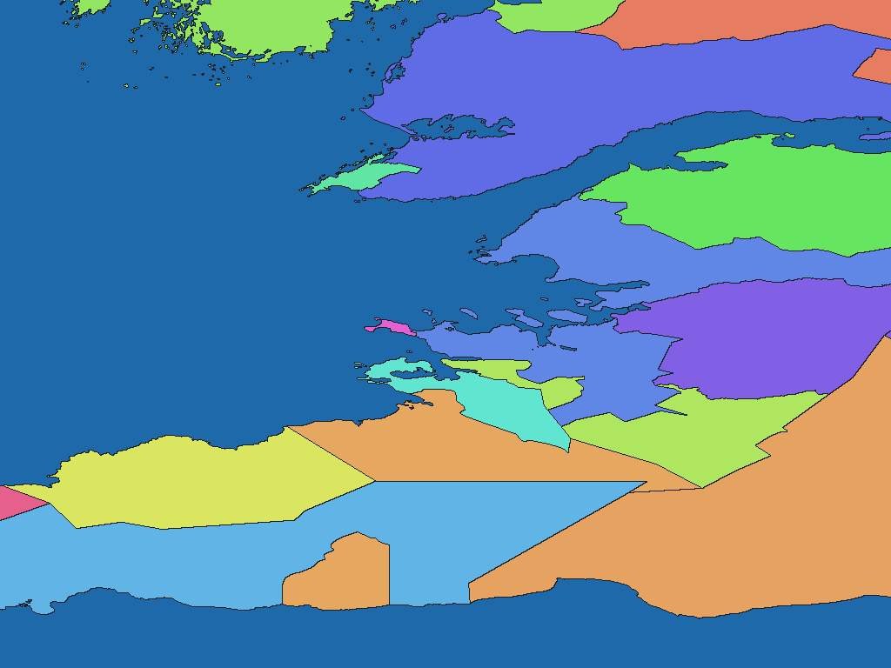

# アイスランド自治体区域（INSPIRE 2022年版）

[English](is-2022-natt-is-is-au-lmi-adm1-rev1.md) | 日本語

[データセット目次に戻る](../../datasets/README.ja.md)

## 概要

原典自治体ポリゴンが表すアイスランド。本島と収録島嶼を含む。 `versionid=INSPIRE 2022-10-04`の2022年版。区域ごとのbeginlifespanversionは全体の版時点とは区別する。

## 区域数

辞書コード単位で **64区域** を収録します。64自治体の一階層。 対象範囲と時点の詳細はZIP内の`data-spec.md`を参照してください。

## ダウンロード

[is-2022-natt-is-is-au-lmi-adm1-rev1.zipをダウンロード（667.7 KiB）](https://github.com/nyatla/galuchat-gis-sdk/releases/download/v0.2.3/is-2022-natt-is-is-au-lmi-adm1-rev1.zip)

このリンクはv0.2.3の公開後に利用できます。ZIPはローカルの`release/`に作成済みです。

## 地図の解像度とサイズ

| unitInv | 南北方向の画素間隔の目安 | WGSMapSetサイズ |
| ---: | ---: | ---: |
| 100 | 約1.1 km | 6.9 KiB |
| 1000（標準） | 約111 m | 67.4 KiB |
| 10000 | 約11 m | 624.6 KiB |

## 辞書

| GisWordBookの文字コード | サイズ |
| --- | ---: |
| UTF-8 | 1.9 KiB |
| UTF-16LE | 1.9 KiB |

同梱の`names.csv`で辞書コードと原典の識別子・名称を照合できます。地図と辞書は同じZIPから選んでください。

### GisWordBookの構造

各レコードは固定1スロットのStringSetです。

| 位置 | 意味 | 空値 |
| ---: | --- | --- |
| 1 | 原典textによる自治体名。 | 不可 |

実データ例（辞書コード`1`）：

```json
["Reykjavíkurborg"]
```

地図の非ゼロ値が辞書コードです。`0`は背景で、辞書レコードを指しません。空スロットがある場合も位置を詰めません。

## 描画例

<a href="../../docs/image/is-2022-natt-is-is-au-lmi-adm1-unit-inv-1000.png"></a>

Reykjavík付近を`unitInv=1000`で描画しました。青色は背景、その他の色は区域コードの区別を示し、色自体に別の意味はありません。

## ライセンスと利用条件

原典：[原典 1](https://www.natt.is/en/resources/open-data/data-download), [原典 2](https://gatt.natt.is/geonetwork/srv/api/records/%7B7CF6A33E-2588-42A8-A483-0B6F729B528A%7D/formatters/xml)。

原典のライセンス・利用条件：**CC BY 4.0 and Náttúrufræðistofnun terms**（[規約 1](https://creativecommons.org/licenses/by/4.0/), [規約 2](https://www.natt.is/en/resources/open-data), [規約 3](https://www-gamli.lmi.is/landupplysingar/leyfi-fyrir-gjaldfrjals-gogn/)）。ZIP内の`NOTICE.md`に出典、適用条件、帰属表示および加工内容を記録しています。

### 商用利用・許諾申請（参考）

原典が示すCC BY 4.0は、条件に従う商用利用を認めています。確認した資料には、この範囲での個別許諾申請の指定はありません。用途に応じて現行の原典条件とZIP内のNOTICE.mdを確認してください。 これは参考情報であり、正式な利用許諾や法的判断を示すものではありません。

### 出典・加工・承認表示

ZIP内の`NOTICE.md`に記載した出典・加工表示を維持してください。この加工データを原典提供者の公式・公認・推奨製品として表示しません。

## 利用上の注意

同じZIPから用途に合う地図1つとGisWordBook1つを選びます。サイズはZIP内ファイルの実サイズ、画素間隔は概算です。区域範囲、コード対応、制約はZIP内の原典文書を確認してください。
