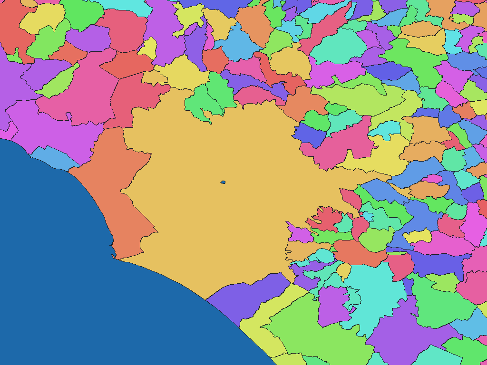

# Istat行政界（2026-01-01、非簡略化版）

[English](it-2026-istat-it-limiti-adm.md) | 日本語

[データセット一覧へ戻る](../../datasets/README.ja.md)

## 概要

イタリアの自治体をGaluchat用の区域図と名称辞書に加工したデータです。原典と加工内容の詳細はZIP内の`data-spec.md`を参照してください。地図の非ゼロ画素値は同梱GisWordBookのコードで、原典IDとの対応は`names.csv`に収録します。

## 区域数

区域数（辞書コード単位）は **7,896件** です。原典仕様：Comune 7,896区域。上位名称階層にはRegione 20区域、上位地域単位110区域を使用する。 上位階層の名称は別個の地図画素値ではありません。

## ダウンロード

[ダウンロード it-2026-istat-it-limiti-adm-rev1.zip（5.93 MiB）](https://github.com/nyatla/galuchat-gis-sdk/releases/download/v0.2.4/it-2026-istat-it-limiti-adm-rev1.zip)

このリンクはv0.2.4公開後に有効になります。ZIPはローカルに準備済みです。

## 地図の解像度とサイズ

| unitInv | 1画素の目安（南北） | ファイル | サイズ |
| ---: | ---: | --- | ---: |
| 100 | 約1.1 km | `italy_istat_2026-grid-512-100.wgsmapset.glc` | 95.5 KiB |
| 1000（標準） | 約111 m | `italy_istat_2026-grid-4096-1000.wgsmapset.glc` | 738.9 KiB |
| 10000 | 約11 m | `italy_istat_2026-grid-8192-10000.wgsmapset.glc` | 5.17 MiB |

## 名称辞書とGisWordBookの構造

| 文字コード | ファイル | サイズ |
| --- | --- | ---: |
| UTF-8 | `italy_istat_2026.giswordbook` | 85.1 KiB |
| UTF-16LE | `italy_istat_2026.utf16.giswordbook` | 85.1 KiB |

各レコードは固定3スロットのStringSetです。

| スロット | 意味 |
| ---: | --- |
| 1 | `DEN_REG`によるRegione名。 |
| 2 | `DEN_UTS`による上位地域単位名。 |
| 3 | `COMUNE`による自治体名。 |

実データの例（辞書コード`1`）：

```json
["Piemonte","Torino","Airasca"]
```

地図と辞書は同じZIPから組み合わせてください。画素値`0`は背景で、水面専用値ではありません。原典IDは`names.csv`で確認できます。

## 表示例

<a href="../../docs/image/it-2026-istat-it-limiti-adm-unit-inv-1000.png"></a>

`unitInv=1000`の地図から描画しています。色はコードの区別用であり、特別な意味はありません。

## ライセンスと利用条件

原典：[原典配布・説明ページ](https://www.istat.it/notizia/confini-delle-unita-amministrative-a-fini-statistici-al-1-gennaio-2018-2/)。ZIP内の`NOTICE.md`に記録された原典の条件は **CC BY 4.0** です。[原典の利用条件](https://creativecommons.org/licenses/by/4.0/)を確認してください。

### 商用利用・許諾申請（参考）

掲載した条件では商用再利用が認められ、通常の再利用について別途の許諾申請はNOTICEに記載されていません。これは参考情報であり、正式な利用許諾や法的判断を示すものではありません。実際の用途に適用される現行の公式規約とZIP内の`NOTICE.md`を確認してください。

### 出典・加工・承認表示

加工製品の再配布時は、ZIP内の`NOTICE.md`に記載された出典・加工内容の表示を維持してください。原典提供者の公式製品や承認済み製品であるかのように表示しないでください。
