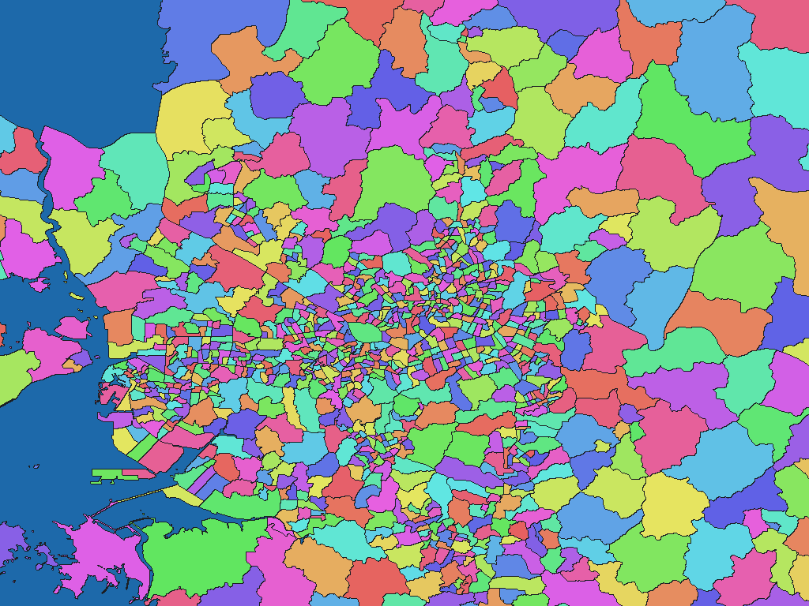

# 韓国SGIS行政洞境界 2025年第2四半期版

[English](kr-sgis-admin-2025.md) | 日本語

[データセット一覧へ戻る](../../datasets/README.ja.md)

## 概要

国家データ処のSGIS行政区域境界を、行政洞ごとの区域図と、市・道／市・郡・区／行政洞の名称辞書として収録します。原典行政コードとの対応は`names.csv`に保持します。同じ公開ZIPの人口等の統計値は収録しません。基準日は2025-06-30です。

## 区域数

区域数（辞書コード単位）は **3,559件** です。採用した原典の行政洞も3,559区域で、本版では異なる区域の名称パスの集約はありません。市・道と市・郡・区は名称階層であり、独立した地図画素値ではありません。

## ダウンロード

[ダウンロード kr-2025-sgis-mods-go-kr-admin-boundary-adm-rev1.zip（2.47 MiB）](https://github.com/nyatla/galuchat-gis-sdk/releases/download/v0.2.4/kr-2025-sgis-mods-go-kr-admin-boundary-adm-rev1.zip)

このリンクはv0.2.4公開後に有効になります。ZIPは現在、ローカルの`release/`に準備済みです。

## 地図の解像度とサイズ

| unitInv | 1画素の目安 | WGSMapSetサイズ |
| ---: | ---: | ---: |
| 100 | 約1.1 km | 34.3 KiB |
| 1000（標準） | 約111 m | 282.6 KiB |
| 10000 | 約11 m | 2.18 MiB |

## 名称辞書

| GisWordBook文字コード | サイズ |
| --- | ---: |
| UTF-8 | 24.7 KiB |
| UTF-16LE | 24.4 KiB |

原典の`SIDO_CD`、`SIGUNGU_CD`、`ADM_CD`と辞書コードの対応は同梱の`names.csv`を参照してください。

### GisWordBookの構造

各レコードは固定3スロットのStringSetです。

| スロット | 意味 | 省略可否 |
| --- | --- | --- |
| 区域1 | 市・道名 | 不可 |
| 区域2 | 市・郡・区名 | 不可 |
| 区域3 | 行政洞名 | 不可 |

実データの例（辞書コード`1`）：

```json
["서울특별시","종로구","사직동"]
```

同じ最下位名でも、全3スロットで別の名称パスなら別コードです。地図の非ゼロ画素値は辞書コード、`0`は背景であり水面専用値ではありません。

## 表示例

<a href="../../docs/image/kr-sgis-admin-2025-unit-inv-1000.png"></a>

ソウル付近を`unitInv=1000`で描画。青は背景、その他の色は区域コードを表します。色自体に意味はありません。

## ライセンスと利用条件

原典：[韓国公的データポータル「국가데이터처_SGIS 행정구역 통계 및 경계_20250630」](https://www.data.go.kr/data/15129688/fileData.do)。

公開ページの利用許諾欄には「이용허락범위 제한 없음」（利用許諾範囲に制限なし）と表示されています。特定のCCライセンス名や著作権放棄は示されていません。本加工物の再配布に際しては原典の識別と加工事実を示す`NOTICE.md`を維持してください。

### 商用利用・許諾申請（参考）

公開ページには個別の利用許諾範囲の制限や申請条件が記されていません。ただし、これは正式な許諾やあらゆる利用の適法性を保証するものではありません。用途に適用される条件を公開元の現行表示およびZIP内の`NOTICE.md`で確認し、不明な点は提供元に問い合わせてください。

### 出典・加工・承認表示

NOTICEには、原典の名称と取得元、行政洞境界の座標変換・親区域対応付け・形式変換の事実、および国家データ処の公認物ではない旨を記載しています。

## 利用にあたって

地図と辞書は必ず同じZIPの組み合わせを使用してください。通常は用途に合う地図とUTF-8辞書を選びます。サイズは実ファイルサイズ、1画素の距離は緯度方向の概算です。原典の行政洞は法定洞ではありません。対象範囲・制約はZIP内の`data-spec.md`、権利情報は`NOTICE.md`を参照してください。
