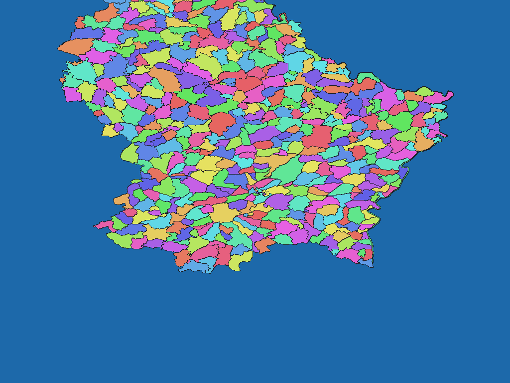

# Luxembourg cadastral sections (5 October 2026 edition)

English | [日本語](lu-2026-data-public-lu-limadmin-cadastral-section.ja.md)

[Back to dataset index](../../datasets/README.md)

## Overview

Cadastral-section boundaries derived from Luxembourg's limadmin data, updated 5 October 2026. Cadastral communes are not the same as current administrative communes.

## Area counts

There are **521 areas by dictionary code**. 521 leaf areas: 519 cadastral sections and two jointly administered areas. Ordinary areas use 12 Canton, 100 administrative Commune and 130 cadastral Commune parent names. Parent names are dictionary levels, not additional pixel values. See the ZIP's `data-spec.md` for exact coverage and dates.

## Download

[Download lu-2026-data-public-lu-limadmin-cadastral-section-rev1.zip (220.6 KiB)](https://github.com/nyatla/galuchat-gis-sdk/releases/download/v0.2.4/lu-2026-data-public-lu-limadmin-cadastral-section-rev1.zip)

This link will work after v0.2.4 is published. The ZIP is already prepared in the local `release/` directory.

## Map resolutions and sizes

| unitInv | Approx. north–south pixel distance | WGSMapSet size |
| ---: | ---: | ---: |
| 100 | approx. 1.1 km | 3.2 KiB |
| 1000 (default) | approx. 111 m | 23.7 KiB |
| 10000 | approx. 11 m | 169.1 KiB |

## Dictionaries

| GisWordBook encoding | Size |
| --- | ---: |
| UTF-8 | 7.3 KiB |
| UTF-16LE | 7.4 KiB |

The included `names.csv` maps dictionary codes to source identifiers and names. Use the map and dictionary from the same ZIP.

### GisWordBook structure

Each record has 4 fixed StringSet slots.

| Position | Meaning |
| ---: | --- |
| 1 | Canton name; empty for joint areas |
| 2 | Administrative Commune name; empty for joint areas |
| 3 | Cadastral Commune name; empty for joint areas |
| 4 | Section name or Condominium |

Actual example (dictionary code `1`):

```json
["Redange","Rambrouch","Arsdorf","Arsdorf"]
```

Nonzero map values are dictionary codes. Code `0` is background and does not identify a dictionary record. Empty slots, where present, are retained rather than shifted.

## Rendering example

<a href="../../docs/image/lu-2026-data-public-lu-limadmin-cadastral-section-unit-inv-1000.png"></a>

Rendered near Luxembourg City at `unitInv=1000`. Blue denotes background; other colours distinguish area codes without additional meaning.

## License and terms of use

Original data: [official source 1](https://data.public.lu/fr/datasets/limites-administratives-du-grand-duche-de-luxembourg/), [official source 2](https://download.data.public.lu/resources/limites-administratives-du-grand-duche-de-luxembourg/20261005-031853/limadmin-shp.zip), [official source 3](https://wms.inspire.geoportail.lu/geoserver/ogc/features/v1/collections/au:AU_Condominium/items?f=application%2Fjson).

Original licence or terms: **CC0 1.0** ([official licence/terms](https://creativecommons.org/publicdomain/zero/1.0/)). The ZIP's `NOTICE.md` records the source, applicable terms, attribution and processing for this release.

### Commercial use and permission applications (informational)

The source identifies CC0 1.0, which does not state a commercial-use or individual-permission requirement for the covered rights. Check NOTICE.md and any rights outside CC0's scope. This is informational, not a formal grant of permission or a legal determination.

### Attribution, modification and approval notices

Preserve the source and modification notices specified in the ZIP's `NOTICE.md`. This processed dataset is not presented as an official, approved or endorsed product of the source provider.

## Usage notes

Select one map resolution and one GisWordBook from this ZIP. File sizes are actual uncompressed member sizes; pixel distances are approximate. The source documents in the ZIP define coverage, code mapping and limitations.
