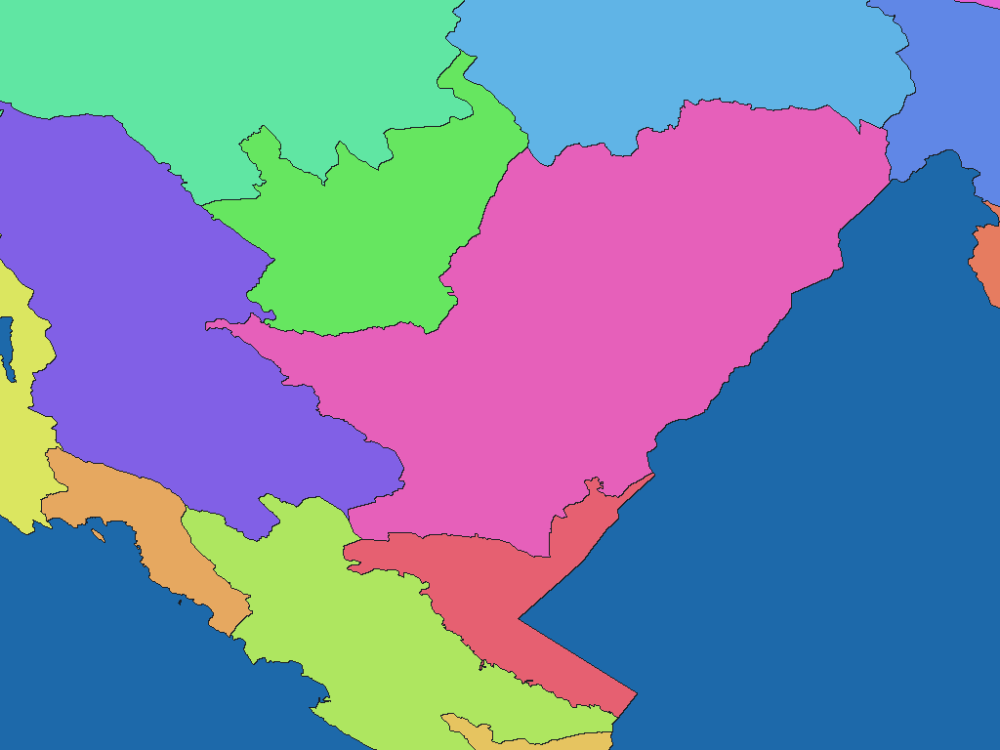

# モンテネグロ原典収録自治体区分（基準年不詳）

[English](me-undated-opendata-gov-me-opstine-adm1.md) | 日本語

[データセット目次に戻る](../../datasets/README.ja.md)

## 概要

原典Opštine.shpに収録されたモンテネグロの範囲。 境界基準年は不詳。`undated`は年度不詳を示す。公開リソース更新日は2024-12-12、DBF書出し日は2024-11-12であり、境界基準年を表さない。

## 区域数

辞書コード単位で **22区域** を収録します。原典26図形。21種類の自治体名称と、原典objectid=22の名称なし区域を収録する。 対象範囲と時点の詳細はZIP内の`data-spec.md`を参照してください。

## ダウンロード

[me-undated-opendata-gov-me-opstine-adm1-rev1.zipをダウンロード（96.4 KiB）](https://github.com/nyatla/galuchat-gis-sdk/releases/download/v0.2.4/me-undated-opendata-gov-me-opstine-adm1-rev1.zip)

このリンクはv0.2.4の公開後に利用できます。ZIPはローカルの`release/`に作成済みです。

## 地図の解像度とサイズ

| unitInv | 南北方向の画素間隔の目安 | WGSMapSetサイズ |
| ---: | ---: | ---: |
| 100 | 約1.1 km | 1.5 KiB |
| 1000（標準） | 約111 m | 10.0 KiB |
| 10000 | 約11 m | 82.5 KiB |

## 辞書

| GisWordBookの文字コード | サイズ |
| --- | ---: |
| UTF-8 | 0.6 KiB |
| UTF-16LE | 0.6 KiB |

同梱の`names.csv`で辞書コードと原典の識別子・名称を照合できます。地図と辞書は同じZIPから選んでください。

### GisWordBookの構造

各レコードは固定1スロットのStringSetです。

| 位置 | 意味 | 空値 |
| ---: | --- | --- |
| 1 | 原典nameによる自治体名または名称なし区域の空文字列。 | 名称なし区域では空文字列 |

実データ例（辞書コード`1`）：

```json
["Andrijevica"]
```

地図の非ゼロ値が辞書コードです。`0`は背景で、辞書レコードを指しません。空スロットがある場合も位置を詰めません。

## 描画例

<a href="../../docs/image/me-undated-opendata-gov-me-opstine-adm1-unit-inv-1000.png"></a>

Podgorica付近を`unitInv=1000`で描画しました。青色は背景、その他の色は区域コードの区別を示し、色自体に別の意味はありません。

## ライセンスと利用条件

原典：[原典 1](https://opendata.gov.me/dataset/zasticena-podrucja-prirode-crne-gore), [原典 2](https://data.gov.me/dataset/189a0ae7-5d0b-419a-a2a0-a1a1ccbda8b8/resource/b82f7fe0-492b-4f8b-873d-9ced4187b6ce/download/optine.zip), [原典 3](https://opendata.gov.me/api/3/action/package_show?id=zasticena-podrucja-prirode-crne-gore)。

原典のライセンス・利用条件：**CC0 1.0**（[規約](https://creativecommons.org/publicdomain/zero/1.0/)）。ZIP内の`NOTICE.md`に出典、適用条件、帰属表示および加工内容を記録しています。

### 商用利用・許諾申請（参考）

原典はCC0 1.0を示しており、その対象権利について商用利用や個別許諾申請の要件は示されていません。CC0の対象外となる権利も含め、NOTICE.mdと原典を確認してください。 これは参考情報であり、正式な利用許諾や法的判断を示すものではありません。

### 出典・加工・承認表示

ZIP内の`NOTICE.md`に記載した出典・加工表示を維持してください。この加工データを原典提供者の公式・公認・推奨製品として表示しません。

## 利用上の注意

同じZIPから用途に合う地図1つとGisWordBook1つを選びます。サイズはZIP内ファイルの実サイズ、画素間隔は概算です。区域範囲、コード対応、制約はZIP内の原典文書を確認してください。
