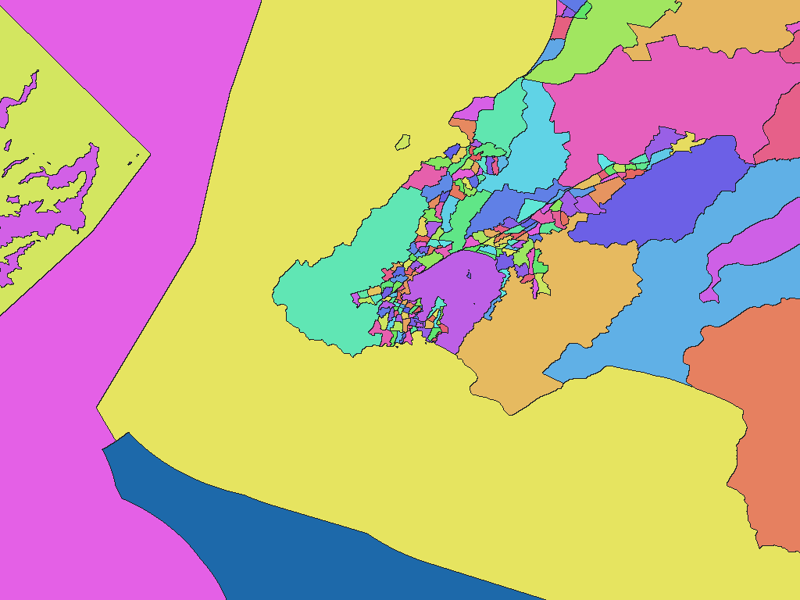

# New Zealand Statistical Area 2, 2026

English | [日本語](nz-2026-stats-govt-nz-sa2-stat-sa2.ja.md)

[Back to dataset index](../../datasets/README.md)

## Overview

Stats NZ Statistical Area 2 (SA2) 2026 boundaries, paired with Territorial Authority (TA) names from Meshblock Higher Geographies 2026. The dictionary uses `[TA name, SA2 name]`, and `names.csv` retains the source codes. Regional Council is not a dictionary level.

## Area counts

There are **2,396 areas by dictionary code**, matching the 2,396 source SA2 areas. Only 2,380 have geometry and can be drawn; the 16 without geometry remain in the dictionary and `names.csv`. This is not the number of areas visible at each resolution.

## Download

[Download nz-2026-stats-govt-nz-sa2-stat-sa2.zip (2.46 MiB)](https://github.com/nyatla/galuchat-gis-sdk/releases/download/v0.2.2/nz-2026-stats-govt-nz-sa2-stat-sa2.zip)

This link will work after v0.2.2 is published. The ZIP is already prepared in the local `release/` directory.

## Map resolutions and sizes

| unitInv | Approx. pixel distance | WGSMapSet size |
| ---: | ---: | ---: |
| 100 | approx. 1.1 km | 33.2 KiB |
| 1000 (default) | approx. 111 m | 273.5 KiB |
| 10000 | approx. 11 m | 2.19 MiB |

## Dictionaries

| GisWordBook encoding | Size |
| --- | ---: |
| UTF-8 | 40.7 KiB |
| UTF-16LE | 40.7 KiB |

The included `names.csv` records SA2 and TA codes and whether geometry exists.

### GisWordBook structure

Each record has two fixed StringSet slots.

| Position | Meaning | Empty values |
| ---: | --- | --- |
| Area 1 | Territorial Authority name; empty for areas outside a TA | Possible |
| Area 2 | SA2 name | Not allowed |

Actual example (dictionary code `1`):

```json
["Far North District","North Cape"]
```

The 42 areas outside a TA have an empty first slot; this does not mean they are all water. Nonzero map values are dictionary codes, and `0` denotes background.

## Rendering example

<a href="../../docs/image/nz-statsnz-sa2-2026-unit-inv-1000.png"></a>

Rendered near Wellington at `unitInv=1000`. Blue denotes background; other colors distinguish area codes. Some water areas also have SA2 codes, so background alone cannot identify water.

## License and terms of use

Sources: [Stats NZ Statistical Area 2 2026](https://datafinder.stats.govt.nz/layer/123515-statistical-area-2-2026/) and [Meshblock Higher Geographies 2026](https://services2.arcgis.com/vKb0s8tBIA3bdocZ/ArcGIS/rest/services/Meshblock_Higher_Geographies_2026/FeatureServer/0).

See [CC BY 4.0](https://creativecommons.org/licenses/by/4.0/) and [Stats NZ copyright/attribution guidance](https://www.stats.govt.nz/about-us/copyright/).

### Commercial use and permission applications (informational)

CC BY 4.0 permits commercial use subject to its attribution and other conditions. Individual permission is generally unnecessary for uses covered by the license. This is informational, not a legal determination; check the official terms and the ZIP's `NOTICE.md`.

### Attribution, modification and approval notices

The NOTICE records:

> This work is based on/includes Stats NZ’s data which are licensed by Stats NZ for reuse under the Creative Commons Attribution 4.0 International licence.
>
> Stats NZのSA2形状・名称および2026年版TA対応を基に、座標変換、TA・SA2の名称階層化、コードの対応付け、区域図・辞書への形式変換を行った。Stats NZは本加工物を承認・推奨していない。

## Usage notes

Always use a map and dictionary from the same ZIP. Typically choose one map and the UTF-8 dictionary. Sizes are actual file sizes and pixel distances are approximate north-south distances. See the ZIP's `data-spec.md` for coverage and limitations and `NOTICE.md` for rights and terms.
