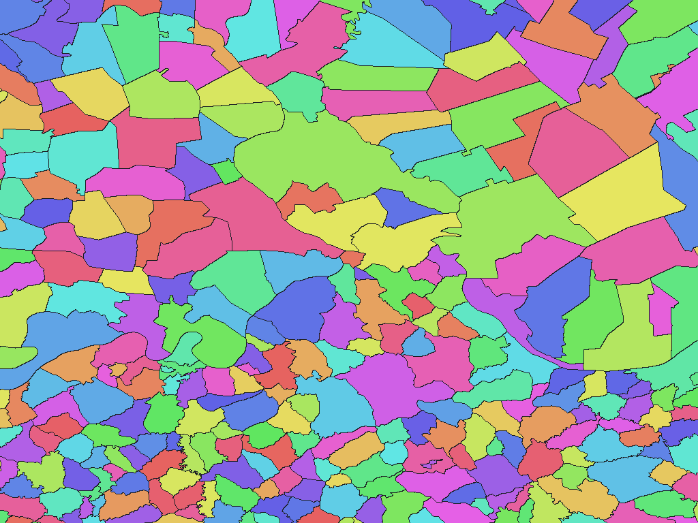

# Serbian Geoanalitičari settlement boundaries (reference year unknown)

English | [日本語](rs-undated-data-gov-rs-hypso-struct-settl-adm-rev1.ja.md)

[Back to dataset index](../../datasets/README.md)

## Overview

Settlement boundaries from Geoanalitičari's Hypso_Struct_Settl distribution, with original municipality and settlement names. The distribution was published on 18 June 2021, but the boundary reference year has not been confirmed. `undated` does not mean current boundaries. The source excludes Kosovo; this describes the source coverage, not political status.

## Area counts

There are **4,721 settlements by dictionary code**. Municipality names form the parent dictionary level and are not separate pixel values. The `names.csv` file maps dictionary codes to the source `MatBrNas` settlement IDs and `MatBrO` municipality IDs.

## Download

[Download rs-undated-data-gov-rs-hypso-struct-settl-adm-rev1.zip (2.47 MiB)](https://github.com/nyatla/galuchat-gis-sdk/releases/download/v0.2.4/rs-undated-data-gov-rs-hypso-struct-settl-adm-rev1.zip)

This link will work after v0.2.4 is published. The ZIP is already prepared in the local `release/` directory.

## Map resolutions and sizes

| unitInv | Approx. north–south pixel distance | WGSMapSet size |
| ---: | ---: | ---: |
| 100 | approx. 1.1 km | 43.1 KiB |
| 1000 (default) | approx. 111 m | 300.5 KiB |
| 10000 | approx. 11 m | 2.08 MiB |

## Dictionaries

| GisWordBook encoding | Size |
| --- | ---: |
| UTF-8 | 33.5 KiB |
| UTF-16LE | 33.5 KiB |

### GisWordBook structure

Each record has two fixed StringSet slots, using the source's Cyrillic names.

| Position | Meaning | Empty values |
| ---: | --- | --- |
| Area 1 | Municipality name (`ImeOpsCir`) | Not allowed |
| Area 2 | Settlement name (`ImeNasCir`) | Not allowed |

Actual example (dictionary code `1`):

```json
["АЛЕКСАНДРОВАЦ","АЛЕКСАНДРОВАЦ"]
```

Nonzero map values are dictionary codes. Code `0` is background, not a water-only value. Use a map and dictionary from the same ZIP.

## Rendering example

<a href="../../docs/image/rs-undated-data-gov-rs-hypso-struct-settl-adm-unit-inv-1000.png"></a>

Rendered near central Belgrade at `unitInv=1000`. Blue denotes background; other colours distinguish area codes without additional meaning.

## License and terms of use

Original data: [Serbian Open Data Portal dataset](https://data.gov.rs/sr/datasets/khipsometrijska-struktura-visinske-zone-opshtina-i-naselja/) and [Geoanalitičari distribution](https://geoanaliticari.github.io/depopulacija/data/Indicator_6/Hypso_Struct_Settl.zip).

Original licence: [Serbian Open Data License 1.0 (SODL)](https://data.gov.rs/sr/terms/). The ZIP's `NOTICE.md` records source provenance, attribution, the download date and processing.

### Commercial use and permission applications (informational)

The cited SODL permits commercial reuse subject to its conditions. The reviewed terms do not specify an individual permission application for use covered by the licence. This is informational, not a formal grant of permission or a legal determination; check the current official terms and the ZIP's `NOTICE.md` for your intended use.

### Attribution, modification and approval notices

Retain the source provider, source URL, download date and changes described in `NOTICE.md`. The NOTICE identifies GeoSrbija/RGZ as boundary provenance according to the distributor; it does not claim direct RGZ distribution or provider approval.

## Usage notes

The ZIP contains three WGSMapSet resolutions, UTF-8 and UTF-16LE GisWordBooks, `names.csv`, `data-spec.md` and `NOTICE.md`. File sizes above are actual uncompressed member sizes. The source's elevation statistics are not included, and the dataset is not a legal boundary determination.
