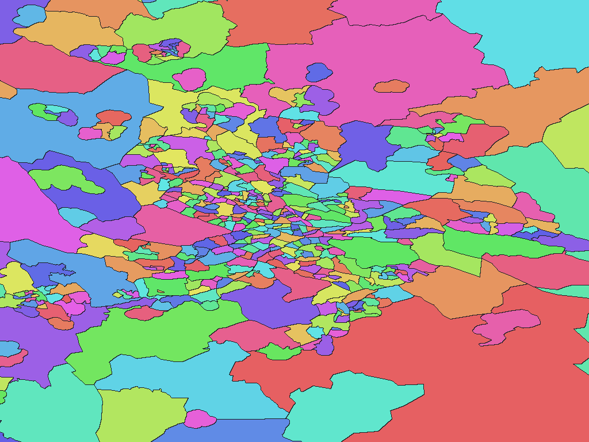

# Swedish RegSO statistical areas, 2025

English | [日本語](se-2025-scb-se-regso-stat-regso-rev1.ja.md)

[Back to dataset index](../../datasets/README.md)

## Overview

This package contains regso statistical areas in Sweden, converted from the source described in the ZIP's `data-spec.md`. Nonzero WGSMapSet pixel values are codes in the accompanying GisWordBook. `names.csv` maps those codes to source identifiers.

## Area counts

**3,363 areas by dictionary code.** The parent levels in the name hierarchy are not separate map pixel values. The source specification records the underlying area counts and any special cases.

## Download

[Download se-2025-scb-se-regso-stat-regso-rev1.zip (3.02 MiB)](https://github.com/nyatla/galuchat-gis-sdk/releases/download/v0.2.4/se-2025-scb-se-regso-stat-regso-rev1.zip)

The download link becomes available after v0.2.4 is published; the ZIP is prepared locally.

## Map resolutions and sizes

| unitInv | Approx. north–south pixel distance | File | Size |
| ---: | ---: | --- | ---: |
| 100 | about 1.1 km | `sweden_regso_2025-grid-512-100.wgsmapset.glc` | 52.0 KiB |
| 1000 (default) | about 111 m | `sweden_regso_2025-grid-4096-1000.wgsmapset.glc` | 368.5 KiB |
| 10000 | about 11 m | `sweden_regso_2025-grid-8192-10000.wgsmapset.glc` | 2.71 MiB |

## GisWordBooks and structure

| Encoding | File | Size |
| --- | --- | ---: |
| UTF-8 | `sweden_regso_2025.giswordbook` | 74.0 KiB |
| UTF-16LE | `sweden_regso_2025.utf16.giswordbook` | 74.0 KiB |

Each dictionary record has 3 fixed StringSet slots:

| Slot | Meaning |
| ---: | --- |
| 1 | County (Län) |
| 2 | Municipality (Kommun) |
| 3 | RegSO |

Actual record at dictionary code `1`:

```json
["Stockholms län","Upplands Väsby","Hammarby-Vaxmyra"]
```

Use a map and dictionary from the same ZIP. Pixel code `0` denotes background, not a separate water class. The `names.csv` file preserves source IDs.

## Rendering example

<a href="../../docs/image/se-2025-scb-se-regso-stat-regso-unit-inv-1000.png"></a>

Rendered from the `unitInv=1000` map; colors distinguish codes without semantic meaning.

## License and terms of use

Source: [Original provider page](https://www.scb.se/vara-tjanster/oppna-data/oppna-geodata/regso/). The source terms recorded in the ZIP's `NOTICE.md` are **CC0 1.0**; see the [Official terms](https://creativecommons.org/publicdomain/zero/1.0/).

### Commercial use and permission applications (informational)

The cited terms permit commercial reuse; the NOTICE does not identify a separate permission application for ordinary reuse. This summary is informational, not a formal grant of permission or a legal determination. Verify the current official terms and the ZIP's `NOTICE.md` for your intended use.

### Attribution, modification and approval notices

Keep the source attribution and processing information in the ZIP's `NOTICE.md` when redistributing the processed product. Do not present it as an official or endorsed product of the source provider.
