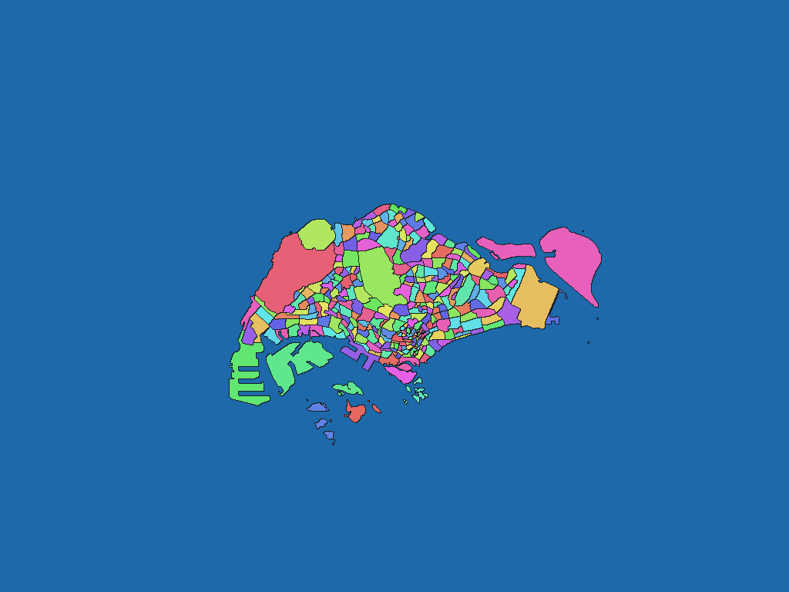

# シンガポールMaster Plan 2019計画区域（No Sea）

[English](sg-2019-data-gov-sg-master-plan-subzone-no-sea-rev1.md) | 日本語

[データセット目次に戻る](../../datasets/README.ja.md)

## 概要

原典No Sea版のSubzoneが表すシンガポールの範囲。原典に収録された島嶼を含む。 Master Plan 2019のURA_MP19_SUBZONE_NO_SEA_PL。採用原典はFMEL_UPD_Dが2019-12-23と2021-09-10のレコードを含む。公式ページのData fromは2021年9月。計画版の2019とデータ更新時点を区別する。

## 区域数

辞書コード単位で **332区域** を収録します。Subzone 332区域。上位名称階層はRegion 5区域とPlanning Area 55区域。 上位名称は辞書階層であり、独立した画素値ではありません。対象範囲と時点の詳細はZIP内の`data-spec.md`を参照してください。

## ダウンロード

[sg-2019-data-gov-sg-master-plan-subzone-no-sea-rev1.zipをダウンロード（78.3 KiB）](https://github.com/nyatla/galuchat-gis-sdk/releases/download/v0.2.4/sg-2019-data-gov-sg-master-plan-subzone-no-sea-rev1.zip)

このリンクはv0.2.4の公開後に利用できます。ZIPはローカルの`release/`に作成済みです。

## 地図の解像度とサイズ

| unitInv | 南北方向の画素間隔の目安 | WGSMapSetサイズ |
| ---: | ---: | ---: |
| 100 | 約1.1 km | 1.2 KiB |
| 1000（標準） | 約111 m | 8.0 KiB |
| 10000 | 約11 m | 50.1 KiB |

## 辞書

| GisWordBookの文字コード | サイズ |
| --- | ---: |
| UTF-8 | 5.0 KiB |
| UTF-16LE | 5.0 KiB |

同梱の`names.csv`で辞書コードと原典の識別子・名称を照合できます。地図と辞書は同じZIPから選んでください。

### GisWordBookの構造

各レコードは固定3スロットのStringSetです。

| 位置 | 意味 | 空値 |
| ---: | --- | --- |
| 1 | Region（計画地域）の名称。 | 不可 |
| 2 | Planning Area（計画区域）の名称。 | 不可 |
| 3 | Subzone（計画下位区域）の名称。 | 不可 |

実データ例（辞書コード`1`）：

```json
["NORTH-EAST REGION","ANG MO KIO","ANG MO KIO TOWN CENTRE"]
```

地図の非ゼロ値が辞書コードです。`0`は背景で、辞書レコードを指しません。空スロットがある場合も位置を詰めません。

## 描画例

<a href="../../docs/image/sg-2019-data-gov-sg-master-plan-subzone-no-sea-unit-inv-1000.png"></a>

Singapore付近を`unitInv=1000`で描画しました。青色は背景、その他の色は区域コードの区別を示し、色自体に別の意味はありません。

## ライセンスと利用条件

原典：[原典](https://data.gov.sg/datasets/d_8594ae9ff96d0c708bc2af633048edfb/view)。

原典のライセンス・利用条件：**Singapore Open Data Licence 1.0**（[規約](https://data.gov.sg/open-data-licence)）。ZIP内の`NOTICE.md`に出典、適用条件、帰属表示および加工内容を記録しています。

### 商用利用・許諾申請（参考）

原典のSingapore Open Data Licenceは商用利用を認めています。再許諾には条件があるため、製品への組込み・再配布時は現行規約とNOTICE.mdを確認してください。通常の許諾範囲について個別申請の指定は確認していません。 これは参考情報であり、正式な利用許諾や法的判断を示すものではありません。

### 出典・加工・承認表示

ZIP内の`NOTICE.md`に記載した出典・加工表示を維持してください。この加工データを原典提供者の公式・公認・推奨製品として表示しません。

## 利用上の注意

同じZIPから用途に合う地図1つとGisWordBook1つを選びます。サイズはZIP内ファイルの実サイズ、画素間隔は概算です。区域範囲、コード対応、制約はZIP内の原典文書を確認してください。
