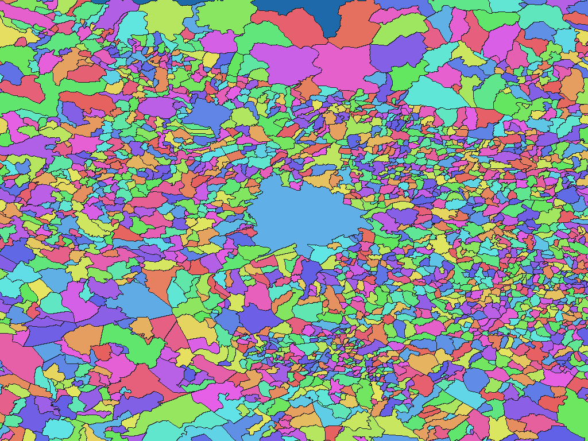

# スロベニアRPE集落区域（2026-09-27配布版）

[English](si-2026-ipi-eprostor-gov-si-rpe-adm.md) | 日本語

[データセット目次に戻る](../../datasets/README.ja.md)

## 概要

原典のNaselje面が表すスロベニア全域。島状部分、飛地および原典区域に含まれる水面を含む。 RPE_SLO_PROSTORSKE_ENOTE_20260927.zipの2026-09-27配布版。ファイル名の版識別日であり、各区域のDATUM_SYSとは区別する。全区域共通の法的な行政界基準日とは断定しない。

## 区域数

辞書コード単位で **6,035区域** を収録します。Naseljeの6,035区域。上位名称はObčina（自治体）の212区域。 上位名称は辞書階層であり、独立した画素値ではありません。対象範囲と時点の詳細はZIP内の`data-spec.md`を参照してください。

## ダウンロード

[si-2026-ipi-eprostor-gov-si-rpe-adm-rev1.zipをダウンロード（1.72 MiB）](https://github.com/nyatla/galuchat-gis-sdk/releases/download/v0.2.4/si-2026-ipi-eprostor-gov-si-rpe-adm-rev1.zip)

このリンクはv0.2.4の公開後に利用できます。ZIPはローカルの`release/`に作成済みです。

## 地図の解像度とサイズ

| unitInv | 南北方向の画素間隔の目安 | WGSMapSetサイズ |
| ---: | ---: | ---: |
| 100 | 約1.1 km | 29.7 KiB |
| 1000（標準） | 約111 m | 197.2 KiB |
| 10000 | 約11 m | 1.33 MiB |

## 辞書

| GisWordBookの文字コード | サイズ |
| --- | ---: |
| UTF-8 | 64.4 KiB |
| UTF-16LE | 64.5 KiB |

同梱の`names.csv`で辞書コードと原典の識別子・名称を照合できます。地図と辞書は同じZIPから選んでください。

### GisWordBookの構造

各レコードは固定2スロットのStringSetです。

| 位置 | 意味 | 空値 |
| ---: | --- | --- |
| 1 | Občina（自治体）の主名称NAZIV。 | 不可 |
| 2 | Naselje（集落）の主名称NAZIV。 | 不可 |

実データ例（辞書コード`1`）：

```json
["Ajdovščina","Ajdovščina"]
```

地図の非ゼロ値が辞書コードです。`0`は背景で、辞書レコードを指しません。空スロットがある場合も位置を詰めません。

## 描画例

<a href="../../docs/image/si-2026-ipi-eprostor-gov-si-rpe-adm-unit-inv-1000.png"></a>

Ljubljana付近を`unitInv=1000`で描画しました。青色は背景、その他の色は区域コードの区別を示し、色自体に別の意味はありません。

## ライセンスと利用条件

原典：[原典 1](https://www.e-prostor.gov.si/podrocja/prostorske-enote-in-naslovi/register-prostorskih-enot/), [原典 2](https://ipi.eprostor.gov.si/jgp/)。

原典のライセンス・利用条件：**CC BY 4.0 and e-Prostor terms**（[規約 1](https://creativecommons.org/licenses/by/4.0/), [規約 2](https://www.e-prostor.gov.si/en/access-to-geodetic-data/)）。ZIP内の`NOTICE.md`に出典、適用条件、帰属表示および加工内容を記録しています。

### 商用利用・許諾申請（参考）

原典が示すCC BY 4.0は、条件に従う商用利用を認めています。確認した資料には、この範囲での個別許諾申請の指定はありません。用途に応じて現行の原典条件とZIP内のNOTICE.mdを確認してください。 これは参考情報であり、正式な利用許諾や法的判断を示すものではありません。

### 出典・加工・承認表示

ZIP内の`NOTICE.md`に記載した出典・加工表示を維持してください。この加工データを原典提供者の公式・公認・推奨製品として表示しません。

## 利用上の注意

同じZIPから用途に合う地図1つとGisWordBook1つを選びます。サイズはZIP内ファイルの実サイズ、画素間隔は概算です。区域範囲、コード対応、制約はZIP内の原典文書を確認してください。
