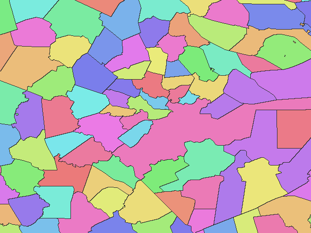

# 米国County Subdivision境界 2025年版

[English](us-stat-census-cousub-2025.md) | 日本語

[データセット一覧へ戻る](../../datasets/README.ja.md)

## 概要

米国国勢調査局の2025年版TIGER/Line® County Subdivisionsを採用した区域図と名称辞書です。50州、District of Columbia、Puerto Rico、American Samoa、Guam、Northern Mariana Islands、United States Virgin Islandsを収録します。辞書はState → County → County Subdivisionの3階層に続けて、末端区域の所属County種別と末端区域自身の種別を属性として返します。

末端にはMinor Civil Division、Census County Division（CCD）、AlaskaのCensus Subarea、Unorganized Territory等を含み、全国一律の自治体区分ではありません。未定義水域区域を含めて原典の区域面を保持し、追加の海岸線クリップは行いません。境界・名称の基準日は2025-01-01です。海外地域やAleutian Islandsを含む座標の扱いは、ZIP内の`data-spec.md`を参照してください。

## 区域数

区域数（辞書コード単位）は **36,498件** で、原典COUSUBの`GEOID`ごとに1件を持ちます。未定義水域138区域も含みます。上位区域や離れたポリゴン成分を別レコードとして数えません。表示5スロットがすべて一致しても、異なるGEOIDには異なるコードを維持します。

小さい区域や狭い区域は粗い解像度では画素として選ばれない場合があり、辞書への収録は全解像度での画素の存在を保証しません。

## ダウンロード

[ダウンロード us-2025-census-gov-tl-stat-cousub-rev1.zip（27.76 MiB）](https://github.com/nyatla/galuchat-gis-sdk/releases/download/v0.2.6/us-2025-census-gov-tl-stat-cousub-rev1.zip)

このZIPはv0.2.6の配布対象です。

英字表示は[en言語パック](../languagepack/en.ja.md)を参照してください。

## 地図の解像度とサイズ

| unitInv | 1画素の目安 | WGSMapSetサイズ |
| ---: | ---: | ---: |
| 100 | 約1.1 km | 698.6 KiB |
| 1000（標準） | 約111 m | 3.77 MiB |
| 10000 | 約11 m | 23.25 MiB |

## 名称辞書

| GisWordBook文字コード | サイズ |
| --- | ---: |
| UTF-8 | 532.9 KiB |
| UTF-16LE | 532.9 KiB |

同梱の`names.csv`は、辞書コードと原典の10桁`GEOID`、所属コード、名称、種別、原典属性を対応付けます。識別子の先頭ゼロは保持します。地図コードはGEOID順の連番であり、GEOIDを整数化した値ではありません。

### GisWordBookの構造

各レコードは5スロットの固定長StringSetです。種別の空欄は`""`として保持し、後続スロットを前へ詰めません。

| スロット | 意味 | 省略可否 |
| --- | --- | --- |
| 区域1 | 原典Stateの`NAME`による州・州相当区域名。 | 不可 |
| 区域2 | 原典Countyの`NAME`によるCounty・County Equivalent名。 | 不可 |
| 区域3 | 原典COUSUBの`NAME`による末端区域名。 | 不可 |
| 属性1 | 末端COUSUBの所属情報としてのCounty種別。`County`、`Parish`等。 | 可（原典に種別表記がない場合は空文字列） |
| 属性2 | 末端COUSUB自身の種別。`town`、`township`、`CCD`等。 | 可（原典に種別表記がない場合は空文字列） |

共通の国名スロットは含めません。名称は原典の`NAME`、種別は原典LSADとともに使われる表記・大文字小文字を保持します。表示パスだけでは区域を一意に識別できません。

実データの例（辞書コード`11503`、GEOID `2501711000`）：

```json
["Massachusetts","Middlesex","Cambridge","County","city"]
```

地図の非ゼロ値が辞書コードです。この例はレコードの0始まりインデックス`11502`に対応します。コード`0`は未設定領域で、辞書レコードではありません。

## 表示例

<a href="../../docs/image/us-stat-census-cousub-2025-unit-inv-1000.png"></a>

BostonとCambridge周辺を`unitInv=1000`で描画しています。青色は未設定領域、その他の色は区域コードを表し、色自体に意味はありません。原典の区域面を保持しているため、色付きの画素にも水域を含みます。

## ライセンスと利用条件

原典：U.S. Census Bureau [2025 TIGER/Line Shapefiles](https://www.census.gov/geographies/mapping-files/time-series/geo/tiger-line-file.2025.html)、[COUSUB原典ZIP一覧](https://www2.census.gov/geo/tiger/TIGER2025/COUSUB/)、同じ版のState・County・LSAD情報。

原典の利用条件：[2025 TIGER/Line技術文書第1章](https://www2.census.gov/geo/pdfs/maps-data/data/tiger/tgrshp2025/TGRSHP2025_TechDoc_Ch1.pdf)。原典metadataの条件、出典・加工表示、商標上の注意をZIP内の`NOTICE.md`に記録しています。

### 商用利用・許諾申請（参考）

NOTICEに記録した原典の条件では、出典・加工表示を維持して、商用利用を含む加工・再配布が可能です。このデータ利用について個別申請を要求する記載は確認されていません。TIGER/Lineの商標はデータとは別に扱い、Census Bureauの公認・推奨製品と表示しないでください。これは参考情報であり、正式な利用許諾や法的判断を示すものではありません。利用方法に適用される条件は公式規約とZIP内のNOTICEで確認してください。

### 出典・加工・承認表示

NOTICEに記載された出典・加工表示：

> Source: U.S. Census Bureau, 2025 TIGER/Line® Shapefiles, County Subdivisions, Counties and Equivalent Entities, States and Equivalent Entities; Legal/Statistical Area Description definitions.
>
> Derived and processed by the Galuchat project. This product is not endorsed by the U.S. Census Bureau.

## 利用にあたって

元の辞書を使う場合は地図と同じZIPから選んでください。通常は用途に合うWGSMapSetを1つとUTF-8辞書を選びます。画素値0は未設定領域で、水陸の分類ではありません。サイズは実ファイルサイズであり、実行時のメモリ使用量ではありません。1画素の距離は緯度方向の概算であり、原典の位置精度を表しません。

対象範囲、座標の扱い、値体系、制約はZIP内の`data-spec.md`、出典、帰属表示、加工内容、利用条件は`NOTICE.md`を参照してください。
