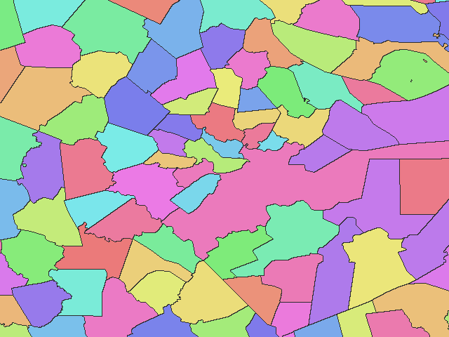

# U.S. county subdivisions, 2025

English | [日本語](us-stat-census-cousub-2025.ja.md)

[Back to dataset index](../../datasets/README.md)

## Overview

U.S. Census Bureau 2025 TIGER/Line® County Subdivisions, covering the 50 states, District of Columbia, Puerto Rico, American Samoa, Guam, the Northern Mariana Islands and the U.S. Virgin Islands. The dictionary returns State → County → County Subdivision, followed by county type and subdivision type as two attributes of the terminal area.

The terminal areas include minor civil divisions, Census County Divisions (CCD), Alaska census subareas and unorganized territories; they are not uniformly municipalities. Source water areas, including undefined water subdivisions, are retained without additional coastline clipping. The source boundary and name reference date is 1 January 2025. See the ZIP's `data-spec.md` for regional coordinate handling, including the overseas areas and Aleutian Islands.

## Area counts

There are **36,498 areas by dictionary code**, one for each source COUSUB `GEOID`, including 138 undefined water areas. Parent areas and disconnected polygon components are not additional dictionary records. Different GEOIDs retain different codes even when all five display slots match.

At coarse resolutions, small or narrow areas may not be selected as pixels; dictionary coverage does not guarantee a pixel for every code at every resolution.

## Download

[Download us-2025-census-gov-tl-stat-cousub-rev1.zip (27.76 MiB)](https://github.com/nyatla/galuchat-gis-sdk/releases/download/v0.2.6/us-2025-census-gov-tl-stat-cousub-rev1.zip)

This ZIP is part of the v0.2.6 release.

For ASCII display names, use the matching dictionary in `datasets/us-2025-census-gov-tl-stat-cousub-rev1/` of the [en language pack](../languagepack/en.md). Match the map ZIP revision exactly.

## Map resolutions and sizes

| unitInv | Approx. pixel distance | WGSMapSet size |
| ---: | ---: | ---: |
| 100 | approx. 1.1 km | 698.6 KiB |
| 1000 (default) | approx. 111 m | 3.77 MiB |
| 10000 | approx. 11 m | 23.25 MiB |

## Dictionaries

| GisWordBook encoding | Size |
| --- | ---: |
| UTF-8 | 532.9 KiB |
| UTF-16LE | 532.9 KiB |

The included `names.csv` maps dictionary codes to the original ten-digit `GEOID`, parent codes, names, types and source attributes. Leading zeros are significant. Map codes are sequential codes in GEOID order, not the numeric value of GEOID.

### GisWordBook structure

Each record is a fixed-length StringSet with five slots. Empty type values remain `""`; later slots are not shifted forward.

| Position | Slot | Meaning | Empty values |
| ---: | --- | --- | --- |
| 1 | Area 1 | State / state-equivalent `NAME` | Required |
| 2 | Area 2 | County / county-equivalent `NAME` | Required |
| 3 | Area 3 | County subdivision `NAME` | Required |
| 4 | Attribute 1 | Terminal subdivision's county affiliation type, such as `County` or `Parish` | Allowed where the source has no type label |
| 5 | Attribute 2 | Subdivision type, such as `town`, `township` or `CCD` | Allowed where the source has no type label |

No common country slot is included. Names preserve the source `NAME`; type labels preserve the spelling and capitalization used with the source LSAD. The display path alone is not a unique area identifier.

Example from the actual data (dictionary code `11503`, GEOID `2501711000`):

```json
["Massachusetts","Middlesex","Cambridge","County","city"]
```

The nonzero map value is the dictionary code. This example corresponds to zero-based record index `11502`. Code `0` denotes unset areas and does not reference a dictionary record.

## Rendering example

<a href="../../docs/image/us-stat-census-cousub-2025-unit-inv-1000.png"></a>

The image shows Boston and Cambridge at `unitInv=1000`. Blue denotes unset areas; other colors distinguish area codes and have no semantic meaning. Colored pixels can include water because the source area shapes are retained.

## License and terms of use

Source: U.S. Census Bureau [2025 TIGER/Line Shapefiles](https://www.census.gov/geographies/mapping-files/time-series/geo/tiger-line-file.2025.html), [COUSUB source ZIPs](https://www2.census.gov/geo/tiger/TIGER2025/COUSUB/), and the same edition's State, County and LSAD information.

Original-data terms: [2025 TIGER/Line technical documentation, chapter 1](https://www2.census.gov/geo/pdfs/maps-data/data/tiger/tgrshp2025/TGRSHP2025_TechDoc_Ch1.pdf). The ZIP's `NOTICE.md` records the source metadata terms, attribution, processing and trademark notices.

### Commercial use and permission applications (informational)

As recorded in the NOTICE, the original government data may be adapted and redistributed, including for commercial use, with the source and processing notices maintained. No individual application requirement is identified for this use of the data. TIGER/Line trademarks are separate from the data, and this product must not be represented as endorsed by the Census Bureau. This is informational, not a formal grant of permission or a legal determination. Refer to the official terms and the ZIP's NOTICE for the conditions applicable to your use.

### Attribution, modification and approval notices

Attribution and modification notices recorded in the NOTICE:

> Source: U.S. Census Bureau, 2025 TIGER/Line® Shapefiles, County Subdivisions, Counties and Equivalent Entities, States and Equivalent Entities; Legal/Statistical Area Description definitions.
>
> Derived and processed by the Galuchat project. This product is not endorsed by the U.S. Census Bureau.

## Usage notes

Always pair a map and dictionary from the same ZIP. Typically choose one WGSMapSet at a suitable resolution and the UTF-8 dictionary. Pixel value 0 denotes an unset area, not a land/water classification. File sizes are not runtime memory requirements; approximate pixel distances refer to the north-south direction and do not express source positional accuracy.

See the ZIP's `data-spec.md` for coverage, coordinate handling, values and limitations, and `NOTICE.md` for sources, attribution, processing and terms of use.
